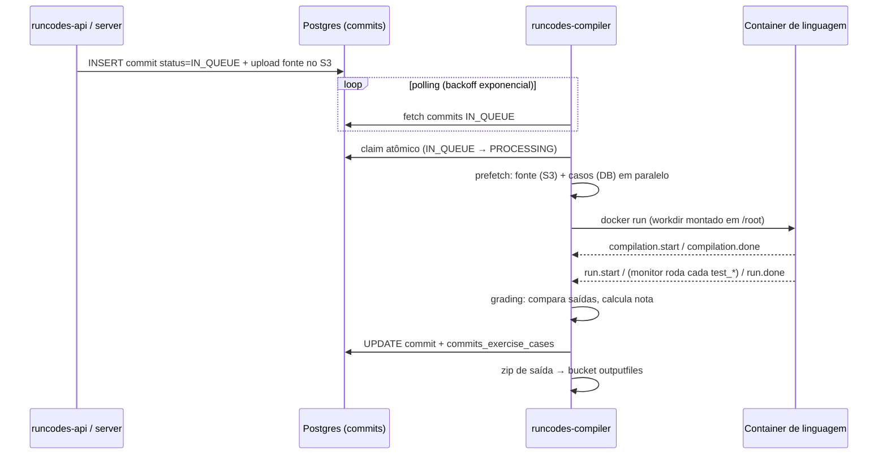

# Pipeline de correção (runcodes-compiler)

Como uma submissão sai de "na fila" e vira nota — e os botões de operação em volta disso.

## Ciclo de vida de um commit



Fases, em detalhe:

1. **Poller** (`poller.py`) — busca `commits` com `status = IN_QUEUE`, filtra duplicados recém-enfileirados (janela de supressão `commit_enqueue_suppression`) e alimenta uma `asyncio.Queue` limitada. Dorme com backoff exponencial quando não há nada; reseta o backoff ao achar.
2. **Consumer** (`consumer.py`) — puxa da fila; cada commit ocupa 1 slot de um semáforo (capacidade = `RUNCODES_COMPILER_CONCURRENCY`, default 8 — é o "quantos commits em paralelo"). O **claim** é um `UPDATE commits SET status = PROCESSING WHERE id = ? AND status = IN_QUEUE` com rowcount check: se outro worker pegou antes, esta instância descarta — é o que permite rodar várias instâncias do engine contra o mesmo banco. Exceções não-retentáveis (`MemoryError`, `OSError`, `SystemExit`) derrubam o consumer inteiro; qualquer outra devolve o commit pra fila pra nova tentativa.
3. **Pipeline** (`pipeline.py`) — recria o diretório de trabalho (`exec_dir/commit_<id>`), baixa em paralelo o fonte (S3) e os casos de teste (DB), grava o `container.config` (limites, timeout, nome do fonte) e copia os arquivos de teste (máx. 8 downloads S3 simultâneos).
4. **Container** (`container.py`) — sobe o container da imagem da linguagem ([runcodes-compiler-images](../architecture/componentes.md#runcodes-compiler-images--imagens-docker-por-linguagem)), monta o diretório de trabalho em `/root` e consome o stream de logs esperando o [protocolo de mensagens](../architecture/contratos.md#o-protocolo-de-sincronização-engine--container). Depois da compilação, se o arquivo de erro não estiver vazio → `STATUS_ERROR`.
5. **Grading** (`grading.py`) — por caso de teste: lê o `monitor_out` (tempo + sinal, escrito pelo [runcodes-compiler-sandbox](../architecture/componentes.md#runcodes-compiler-sandbox--sandbox-de-recursos-c)), baixa a saída esperada do S3 e compara (`text_cmp`/`text_cmp2`/`number_cmp` ou binária). Resultado por caso: `CORRECT`/`INCORRECT`/`MALFORMED`. Nota = `10 × corrects/total`; status final `COMPLETED` ou `INCOMPLETE`.
6. **Store** — grava commit + resultados por caso no banco, sobe o zip de saída pro bucket `outputfiles`, limpa o diretório de trabalho. Falha em qualquer etapa → `_fail_commit` marca `STATUS_INTERNAL_ERROR` e, conforme `cleanup_on_error`, **preserva o diretório de trabalho pra inspeção manual**.

## Configuração (variáveis de ambiente)

| Grupo | Variáveis |
|---|---|
| Banco | `RUNCODES_DB_HOST` / `PORT` / `DATABASE` / `USERNAME` / `PASSWORD`, `RUNCODES_DB_POOL_MIN_SIZE`, `RUNCODES_DB_POOL_MAX_SIZE` (default = concorrência + 2), `RUNCODES_DB_POOL_TIMEOUT` |
| S3/SeaweedFS | `RUNCODES_S3_REGION`, `RUNCODES_S3_ENDPOINT` (default `http://seaweed:8333`), `RUNCODES_S3_CREDENTIALS_KEY`/`SECRET`, `RUNCODES_S3_BUCKET_PREFIX` (default `runcodes` → buckets `runcodes-commits`, `-outputfiles`, `-files`, `-cases`) |
| Paralelismo | `RUNCODES_COMPILER_CONCURRENCY` (default 8), `RUNCODES_COMPILER_ENQUEUE_SUPPRESSION` |
| Execução | `RUNCODES_COMPILER_EXEC_DIR` (default `/tmp`), `RUNCODES_COMPILER_EXEC_DIR_REMOTE` (caminho no host quando o engine roda em container e monta volume pra um container-irmão — "Docker-out-of-Docker" via socket), `RUNCODES_DEFAULT_COMPILATION_TIMEOUT` (10s), `RUNCODES_DEFAULT_EXEC_TIMEOUT` (5s) |

Também aceita config via arquivo JSON (`config/rcc/config.json.example`). O engine precisa de `/var/run/docker.sock` montado.

:::warning Capacidade é acoplada
Subir `RUNCODES_COMPILER_CONCURRENCY` sem subir os recursos do host Docker (CPU/RAM) e o pool de conexões só move o gargalo. O pool do banco já acompanha (concorrência + 2 por default); os downloads S3 simultâneos são capados em 8 independentemente.
:::

## Recompilação de commits

Pela API/UI (staff): **recompilar um commit** (`POST /commits/:id/recompile`) ou **recompilar o exercício** (`POST /exercises/:id/commits/recompile-all`, que reenfileira a submissão mais recente de cada aluno). Nos dois casos a operação é só: `status → IN_QUEUE`, limpa `compiled`/`compiled_message`/`corrects`/`score` e apaga os resultados de caso antigos — o engine pega como se fosse uma submissão nova. Não-admin não recompila um commit já em processamento; exercícios não-compiláveis (`type = 1`) são rejeitados. Detalhes de API em [commits](../backend/commits.md#correção-manual-e-reprocessamento).

Recompilação em massa direto no banco (último recurso, com o engine rodando):

```sql
-- reenfileira a submissão mais recente de cada aluno de um exercício
UPDATE commits SET status = 0, compiled = NULL, compiled_message = NULL,
       corrects = NULL, score = NULL
WHERE id IN (SELECT max(id) FROM commits WHERE exercise_id = :id GROUP BY user_id);
```

Prefira sempre a rota da API — ela também limpa `commits_exercise_cases` e registra a ação no [log de auditoria](./logs-e-auditoria.md).

## Adicionando uma linguagem

1. Criar `runcodes-compiler-images/<nome>/` com `Dockerfile` (`FROM .../runcodes-compiler-images-base`) e `<nome>-script.sh` definindo `compilation_command`/`run_command`.
2. Buildar/publicar a imagem (`make all` no repo `runcodes-compiler-images`).
3. Registrar em `runcodes-compiler/src/rcc/languages.py` (nome → imagem → flags como `is_compilable`).
4. Cadastrar a extensão no catálogo [`allowed_files`](../gestao/tipos-de-arquivo.md) pra que exercícios possam oferecê-la.

Uma linguagem só funciona ponta a ponta quando existe **nos três lugares** (imagem, `languages.py`, catálogo).

## Observabilidade do worker

- Logs do processo (`docker logs` do container do engine, ou journald conforme o deploy) — cada fase do pipeline loga início/fim e erros com o id do commit.
- Commits em `STATUS_INTERNAL_ERROR` com `cleanup_on_error` desligado deixam o diretório `exec_dir/commit_<id>` no host pra autópsia (fonte, `container.config`, saídas parciais, `monitor_out`).
- Sintomas e diagnóstico dos problemas comuns: [Troubleshooting](../troubleshooting.md).
