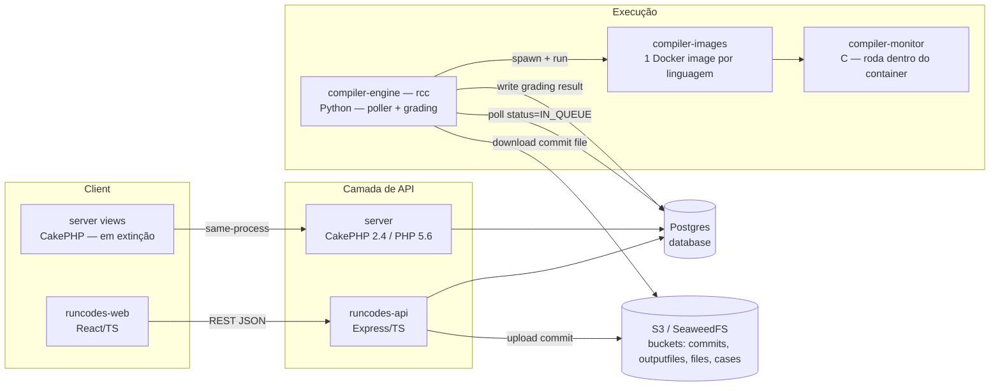

# Arquitetura do sistema

## Componentes

Dois pontos centrais que guiam toda decisão de arquitetura:

1. **`database` é a interface de integração.** `runcodes-api` e `server` escrevem/leem a mesma tabela `commits`; `compiler-engine` não sabe (nem precisa saber) qual dos dois gerou a linha — ele só faz polling por `status = IN_QUEUE`. Isso é o que torna a migração incremental possível sem reescrever o engine.
2. **S3 é o contrato de arquivo.** `aws_key` na tabela `commits` é uma chave opaca dentro do bucket `*-commits` — quem a escreve (PHP ou Node) não importa, só que o engine consiga fazer `GetObject` nela.

## Fluxo de uma submissão (commit)

1. Aluno envia arquivo via `POST /api/exercises/:id/commits` (runcodes-api) ou via o form legado (server).
2. API valida: exercício aberto (ou staff), extensão permitida, tamanho dentro do limite.
3. API sobe o arquivo pro bucket `runcodes-commits` e insere uma linha em `commits` com `status = 0` (IN_QUEUE).
4. `compiler-engine` (processo Python independente, já rodando) faz polling, encontra a linha, reivindica atomicamente (`UPDATE ... WHERE status = IN_QUEUE` com rowcount check — evita duas corridas pegarem o mesmo commit).
5. Engine baixa o arquivo do S3, sobe um container Docker (`compiler-images`) com o `compiler-monitor` dentro medindo tempo/memória/sinais, roda os casos de teste.
6. Engine grava de volta `status`, `corrects`, `score`, `compiled_message` etc. na mesma linha de `commits`.
7. Cliente (web ou API) faz polling em `GET /api/commits/:id` até o status sair de `IN_QUEUE`.

Esse fluxo foi [verificado de ponta a ponta](../backend/testing.md) contra o engine real, não é só desenho.

## Autenticação

`runcodes-api` usa JWT (stateless). O `server` legado usa sessão PHP (`CakeAuth`). As duas coexistem: a migração de senha é transparente — no primeiro login bem-sucedido contra um hash sha1 legado (`sha1(salt + senha)`, formato CakePHP `AuthComponent::password()`), a API reescreve o hash para bcrypt. Depois disso o usuário só consegue logar pela nova API (o PHP legado perde a capacidade de validar aquele hash) — então essa migração é **um caminho sem volta por usuário**, deliberadamente: força a adoção gradual do novo backend sem downtime coordenado.
